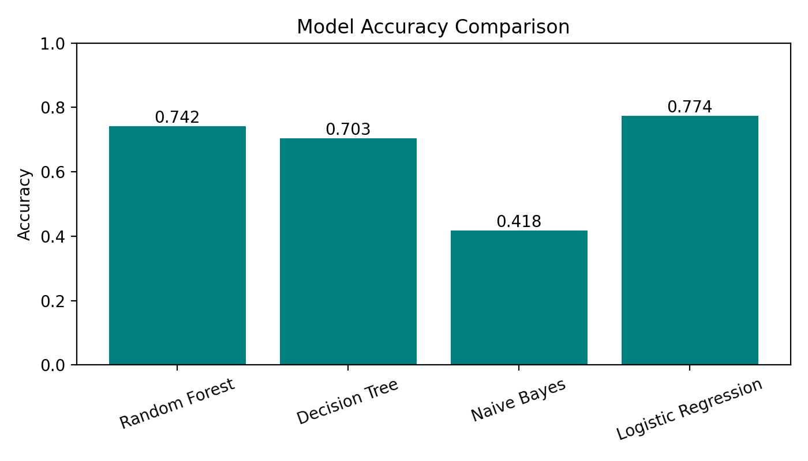
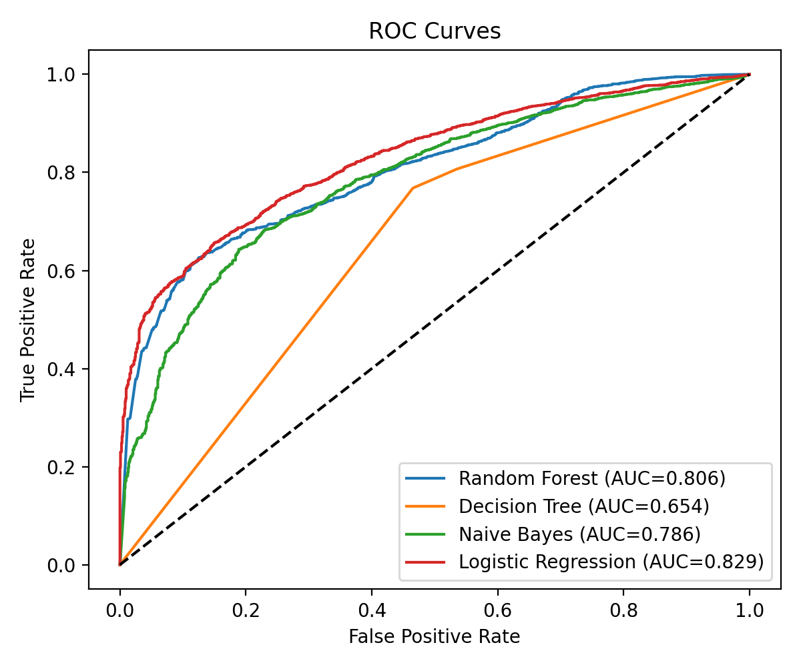

# Phishing Website Detector

A small Flask app that classifies a URL using a Logistic Regression model trained on character-count features. The app includes a model-comparison dashboard.

## Setup

1. Install Python 3.10 or newer.
2. From this directory, create and activate a virtual environment:

   ```powershell
   py -m venv venv
   .\venv\Scripts\Activate.ps1
   ```

   On macOS or Linux, use `python3 -m venv venv` and `source venv/bin/activate`.
3. Install the pinned dependencies:

   ```shell
   python -m pip install -r requirements.txt
   ```
4. Start the app:

   ```shell
   python app.py
   ```
5. Open http://127.0.0.1:5000/ in your browser. Use **Dashboard** to view model comparison results.

The model and feature-order files (`model.pkl` and `features.pkl`), templates, static assets, and `results.csv` are included. The raw training CSV is not included. It is available from the [Kaggle Web Page Phishing dataset](https://www.kaggle.com/datasets/danielfernandon/web-page-phishing-dataset/data).

## Dashboard visuals





## Training notebook

The training notebook is at [`notebooks/train.ipynb`](notebooks/train.ipynb). It uses Colab-specific `files.upload()` and `files.download()`, so it is meant to run in Google Colab. Upload the Kaggle CSV when prompted; the CSV is not stored in this repository.

## Limitations

The reported accuracy is 77%. Predictions use lexical URL features only: the app counts URL characters and does not inspect page content, domain registration, redirects, or live reputation data. Treat results as a rough signal, not a safety guarantee.
